# Jaago Teaching Portal Architecture

## Table of Contents

- [Project Overview](#project-overview)
- [Tech Stack](#tech-stack)
- [High-Level System Architecture](#high-level-system-architecture)
- [Repository & Folder Structure](#repository--folder-structure)
- [Frontend Architecture](#frontend-architecture)
- [Backend Architecture](#backend-architecture)
- [Database Architecture](#database-architecture)
- [API Reference](#api-reference)
- [Key Data & Control Flows](#key-data--control-flows)
- [Security Architecture](#security-architecture)
- [Configuration & Environment](#configuration--environment)
- [Build/Run/Deployment](#buildrundeployment)
- [Cross-Cutting Concerns](#cross-cutting-concerns)
- [Dependency Map](#dependency-map)
- [Discrepancies & Technical Debt](#discrepancies--technical-debt)
- [Improvement Recommendations](#improvement-recommendations)
- [Glossary](#glossary)

## Project Overview

Jaago Teaching Portal is a full-stack volunteer and student operations system with a TanStack Start/React frontend and a Django REST Framework backend. The implementation supports volunteer and student registration, role-based sign-in, Admin 1 attendance, and Admin 2 operational workflows such as daily status, holidays, volunteer assignments, XP, cautions, removal/access requests, and reporting exports.

The frontend is organized as file-based routes under `frontend/src/routes`. The backend exposes JSON REST APIs under `/api/`, plus Django's `/admin/` interface. PostgreSQL is the default production-style database; SQLite can be selected with `USE_SQLITE=true`.

## Tech Stack

### Frontend versions from `frontend/package.json`

| Category | Package / tool | Declared version |
|---|---|---|
| Framework | React | `^19.2.0` |
| Framework DOM | React DOM | `^19.2.0` |
| Routing | TanStack React Router | `1.170.18` |
| Full-stack framework | TanStack React Start | `1.168.32` |
| Server state | TanStack React Query | `^5.101.1` |
| HTTP client | Axios | `^1.20.0` |
| Build tool | Vite | `8.1.5` |
| Styling | Tailwind CSS | `^4.2.1` |
| Styling plugin | `@tailwindcss/vite` | `^4.2.1` |
| Type system | TypeScript | `^5.8.3` |
| Forms | React Hook Form | `^7.71.2` |
| Validation | Zod | `^3.25.76` |
| UI primitives | Radix UI packages | Various `^1.x`/`^2.x` versions |
| Charts | Recharts | `^2.15.4` |
| Spreadsheet export/import | `xlsx` | `^0.18.5` |
| Icons | Lucide React | `^0.575.0` |

### Backend versions from `backend/requirements.txt`

| Category | Package | Declared version |
|---|---|---|
| Web framework | Django | `6.1.1` |
| REST framework | Django REST Framework | `3.18.1` |
| JWT | djangorestframework-simplejwt | `5.5.1` |
| JWT implementation | PyJWT | `2.14.0` |
| CORS | django-cors-headers | `4.9.0` |
| PostgreSQL driver | psycopg2-binary | `2.9.13` |
| Environment | python-dotenv | `1.2.3` |
| Image/export support | Pillow | `12.3.0` |
| Excel support | openpyxl | `3.1.5` |
| ASGI/WSGI server | gunicorn | `26.2.0` |
| Email provider client | resend | Unpinned |
| SQL parser | sqlparse | `0.6.0` |
| ASGI support | asgiref | `3.12.1` |

## High-Level System Architecture

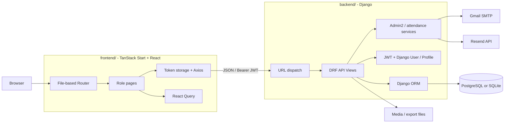

## Repository & Folder Structure

```text
new_jaggoportal/
├── SETUP_GUIDE.md                 # Local setup and demo-login instructions
├── ARCHITECTURE.md                # This system architecture document
├── Reference/                     # Product requirements PDFs
├── frontend/                      # TanStack Start React application
│   ├── src/routes/                # File-based page routes
│   ├── src/admin1/                # Admin 1 components
│   ├── src/admin2/                # Admin 2 layout and operations components
│   ├── src/auth/                  # Auth and volunteer access components
│   ├── src/signup/                # Registration components
│   ├── src/volunteer/             # Volunteer page components
│   ├── src/components/            # Shared UI components
│   ├── src/services/api.js        # Axios, JWT storage, login/demo helpers
│   ├── src/hooks/                 # Shared React hooks
│   ├── src/lib/                   # Shared utilities
│   ├── src/styles.css             # Tailwind and Jaago design tokens
│   ├── package.json               # Frontend dependencies and scripts
│   └── vite.config.ts             # TanStack/Vite/Nitro configuration
└── backend/
    ├── manage.py                  # Django command entry point
    ├── requirements.txt           # Python dependencies
    ├── config/                    # Settings, root URLConf, WSGI
    ├── accounts/                  # User profile and authentication
    ├── teachers/                  # Volunteer registration and work workflows
    ├── courses/                   # Course and subject catalog
    ├── students/                  # Student registration, XP and homework
    ├── attendance/                # Admin 1 attendance sessions and records
    ├── admin2/                    # Status, assignments, XP, cautions and access
    └── timetable/                 # Installed placeholder app with no models/routes
```

## Frontend Architecture

### Route inventory

| Path | Component / route file | Intended role | Public or protected |
|---|---|---|---|
| `/` | `routes/index.tsx` | All users | Public |
| `/toolkit` | `routes/toolkit.tsx` | General/testing | Public |
| `/admin1/attendance-dashboard` | `routes/admin1.attendance-dashboard.tsx` | Admin 1 | Protected; Admin 1 JWT/profile |
| `/admin1/history` | `routes/admin1.history.jsx` | Admin 1 | Protected; Admin 1 JWT/profile |
| `/admin1/signin` | `routes/admin1.signin.jsx` | Admin 1 | Public sign-in |
| `/admin1/forgot-password` | `routes/admin1.forgot-password.jsx` | Admin 1 | Public |
| `/admin1/reset-password` | `routes/admin1.reset-password.jsx` | Admin 1 | Public reset form |
| `/admin2` | `routes/admin2.jsx` | Admin 2 shell | Protected; Admin 2 |
| `/admin2/` | `routes/admin2.index.jsx` | Admin 2 redirect | Redirect to `/admin2/dashboard` |
| `/admin2/dashboard` | `routes/admin2.dashboard.jsx` | Admin 2 | Protected; Admin 2 |
| `/admin2/overview` | `routes/admin2.overview.jsx` | Admin 2 | Protected; Admin 2 |
| `/admin2/access-requests` | `routes/admin2.access-requests.jsx` | Admin 2 | Protected; Admin 2 |
| `/admin2/assignments` | `routes/admin2.assignments.jsx` | Admin 2 | Protected; Admin 2 |
| `/admin2/caution` | `routes/admin2.caution.jsx` | Admin 2 | Protected; Admin 2 |
| `/admin2/daily-png` | `routes/admin2.daily-png.jsx` | Admin 2 | Protected; Admin 2 |
| `/admin2/forgot-password` | `routes/admin2.forgot-password.jsx` | Admin 2 | Public |
| `/admin2/reset-password` | `routes/admin2.reset-password.jsx` | Admin 2 | Public |
| `/admin2/holidays` | `routes/admin2.holidays.jsx` | Admin 2 | Protected; Admin 2 |
| `/admin2/roster` | `routes/admin2.roster.jsx` | Admin 2 | Protected; Admin 2 |
| `/admin2/school-day-status` | `routes/admin2.school-day-status.jsx` | Admin 2 | Protected; Admin 2 |
| `/admin2/signin` | `routes/admin2.signin.jsx` | Admin 2 | Public sign-in |
| `/admin2/students/` | `routes/admin2.students.index.jsx` | Admin 2 | Protected; Admin 2 |
| `/admin2/students/$rollNo` | `routes/admin2.students.$rollNo.jsx` | Admin 2 | Protected; Admin 2 |
| `/admin2/volunteers/` | `routes/admin2.volunteers.index.jsx` | Admin 2 | Protected; Admin 2 |
| `/admin2/volunteers/$id` | `routes/admin2.volunteers.$id.jsx` | Admin 2 | Protected; Admin 2 |
| `/student/signup` | `routes/student.signup.jsx` | Volunteer-entered student registration | Public page; backend registration currently `AllowAny` |
| `/reset-password/$uid/$token` | `routes/reset-password.$uid.$token.jsx` | All password-reset recipients | Public reset confirmation |
| `/teacher/signin` | `routes/teacher.signin.jsx` | Volunteer / teacher | Public sign-in |
| `/teacher/signup` | `routes/teacher.signup.jsx` | Volunteer / teacher | Public registration |
| `/teacher/forgot-password` | `routes/teacher.forgot-password.jsx` | Volunteer / teacher | Public |
| `/teacher/reset-password` | `routes/teacher.reset-password.jsx` | Volunteer / teacher | Public reset form |
| `/volunteer/dashboard` | `routes/volunteer.dashboard.jsx` | Volunteer / teacher | Protected; volunteer JWT/profile |
| `/volunteer/teaching` | `routes/volunteer.teaching.jsx` | Volunteer teaching team | Protected; volunteer JWT/profile |
| `/volunteer/checking` | `routes/volunteer.checking.jsx` | Volunteer checking team | Protected; volunteer JWT/profile |
| `/volunteer/special-added` | `routes/volunteer.special-added.jsx` | Special-added present volunteer | Protected; volunteer JWT/profile |
| `/volunteer/request-access` | `routes/volunteer.request-access.jsx` | Removed volunteer | Public request submission |

### Page-by-page breakdown

- `/` provides role selection/navigation to Admin 1, Admin 2, volunteer, and signup flows.
- Admin 1 pages cover sign-in, forgot/reset, attendance-session operations, and attendance history.
- Admin 2 shell/layout wraps dashboard, overview, day status, holidays, students, volunteers, cautions, requests, assignments, and daily reports.
- Student signup delegates to the student registration component and renders backend-generated roll number results.
- Teacher/volunteer signup and sign-in use course/subject and user-ID/password flows.
- Volunteer dashboard shows today's assignment/work status; teaching and checking pages record progress/homework; special-added work selects one authorized absent-assignment replacement.
- Password-reset pages cover role-specific entry and the generic UID/token confirmation link.
- The toolkit route exposes general UI/tooling.

### State management

- Server/API state is read and mutated with Axios; `src/services/api.js` owns the shared client and JWT interceptors.
- TanStack React Query is installed at the root `QueryClientProvider`, although many route components currently use component-local `useState`/`useEffect` rather than query hooks.
- Auth state is persisted in `localStorage` keys `jaago_access_token`, `jaago_refresh_token`, `jaago_role`, and `jaago_user`.
- Route-local state handles loading, form values, selected students/volunteers, attendance status, and operation results.
- The generated `routeTree.gen.ts` and `router.tsx` provide TanStack route integration.

### Auth flow

- Admin 1/Admin 2 use `POST /api/auth/login/` with username/password and receive profile role plus SimpleJWT tokens.
- Volunteers use `POST /api/teachers/login/` with `user_id/password`.
- Demo sign-in uses `POST /api/auth/demo-login/` for `ADMIN1`, `ADMIN2`, or `VOLUNTEER` when `DEMO_MODE=true`.
- Axios adds `Bearer` access tokens to API requests except login/demo/teacher-login URLs.
- On a non-login 401, the shared interceptor clears local auth state; no refresh endpoint is currently wired.
- Password reset requests and confirmations use public account endpoints.
- Frontend route guards are sparse: `/admin2/` redirects by route name, while most role protection is effectively backend permission enforcement rather than route-level TanStack guards.

### Styling

- Tailwind CSS 4 is loaded through `styles.css` and Vite.
- `styles.css` defines light/dark OKLCH design tokens and semantic present/absent/special colors.
- Shared components use Radix UI primitives, CVA, and Tailwind utility classes.
- Admin 2 has a dedicated layout/theme and utility styles in `src/admin2/`.
- Jaago-specific pages use `.jaago-page`, fixed ornaments, warm green/violet palettes, and reduced-motion handling.

## Backend Architecture

### Django applications

| App | Models | Serializers | Views | URLs | Permissions |
|---|---|---|---|---|---|
| `accounts` | `UserProfile` plus Django `User` | `UserProfileSerializer`, `AdminAccountCreateSerializer`, login/reset serializers | Login, demo login, password reset request/confirm, current user | `/api/auth/login/`, `/api/auth/demo-login/`, `/api/auth/forgot-password/`, `/api/auth/reset-password/<uid>/<token>/`, `/api/auth/me/` | `AllowAny` for auth/reset/demo; `IsAuthenticated` for `/me/`; role permissions in `permissions.py` |
| `courses` | `Course`, `Subject` | `CourseSerializer`, `SubjectSerializer` | Course/subject list | `/api/courses/`, `/api/subjects/` | `AllowAny` |
| `teachers` | `RegistrationSequence`, `Teacher`, `VolunteerWorkSession`, `StudentProgress`, `SpecialAddedWorkAccess`, `StudentChecking` | Registration, dashboard, progress, checking, and work-session serializers | Registration/login, dashboard, assignment/work sessions, progress, checking, special-added work | `/api/teachers/*` | Mostly `IsTeacherVolunteer`; registration/login public; account-status checks are applied in login/work views |
| `students` | `StudentRegistrationSequence`, `Student`, `StudentHomework`, `StudentXPTransaction` | Registration, homework completion, XP and 14-day serializers | Register, complete homework, XP detail/leaderboard, 14-day history | `/api/students/*` | Registration `AllowAny`; XP/checking endpoints use authenticated/admin permissions as implemented |
| `attendance` | `Holiday`, `AttendanceSession`, `StudentAttendance`, `VolunteerAttendance` | Session, student attendance, volunteer attendance | Start/current/end session, student/volunteer lists and saves, summary/history | `/api/attendance/*` | Admin 1/superuser permissions, with authenticated lists for relevant workflows |
| `admin2` | `DailySchoolStatus`, `VolunteerAssignment`, `VolunteerXPTransaction`, `VolunteerCaution`, `VolunteerAccountStatus`, `VolunteerAccessRequest`; imports `Holiday` from attendance | Daily status, holidays, volunteer, assignment, XP, caution, account/status and access request serializers | Dashboard/status/holidays, registered/present lists, assignments/export/email, XP, cautions/removal/access requests | `/api/admin2/*` | `IsAdmin2`, with public removed-volunteer access request endpoint |
| `timetable` | None in read models | None | No `urls.py`; app placeholder | None | None |

### Management commands

| Command | App | Purpose |
|---|---|---|
| `python manage.py seed_demo_data` | `accounts` | Seeds courses, subjects, `admin1`/`admin2`, profiles and demo volunteer. |
| `python manage.py bootstrap_admins` | `accounts` | Idempotently creates/updates Admin 1 and Admin 2 from environment variables. |
| `python manage.py bootstrap_superuser` | `accounts` | Idempotently creates/updates the Django superuser from environment variables. |
| `python manage.py test_real_email` | `admin2` | Sends a hard-coded Gmail SMTP test email. |

### Authentication and role model

Django's built-in `auth.User` is the identity object. `accounts.UserProfile` adds the application role:

- `ADMIN1`
- `ADMIN2`
- `TEACHER_VOLUNTEER`
- `STUDENT`

`Teacher` also links one-to-one to a Django `User` for volunteer authentication and stores a separate hashed password field. JWTs use the Django user and `IsAuthenticated`/custom profile permissions.

## Database Architecture

### Models and relationships

| App / model | Fields | Relationships |
|---|---|---|
| `auth.User` (Django) | username, first_name, last_name, email, password, active/staff/superuser flags | One `UserProfile`; optional one `Teacher`; created-by/actor relations across several models |
| `accounts.UserProfile` | `role`, `is_active`, `created_at`, `updated_at` | One-to-one to `auth.User` |
| `courses.Course` | `name` unique | One-to-many to `Teacher` |
| `courses.Subject` | `name` unique | One-to-many to `Teacher` |
| `teachers.RegistrationSequence` | `value` | Global volunteer-ID sequence counter |
| `teachers.Teacher` | `user_id`, `name`, `joining_year`, `email`, `whatsapp_number`, `free_days`, `password`, `created_at` | Optional one-to-one `auth.User`; course and subject; assignments/work/attendance/status relations |
| `teachers.VolunteerWorkSession` | `started_at`, `ended_at`, `total_seconds`, `status`, timestamps | Assignment to `VolunteerAssignment`; volunteer `Teacher` |
| `teachers.StudentProgress` | `performance`, `feedback`, `homework_given`, timestamps | Assignment, work session, volunteer and student |
| `teachers.SpecialAddedWorkAccess` | `access_date`, `status`, `selected_at`, `completed_at` | One-to-one assignment and volunteer attendance; one special volunteer |
| `teachers.StudentChecking` | `homework_status`, `feedback`, `checked_at`, `created_at` | Assignment, work session, volunteer and student |
| `students.StudentRegistrationSequence` | `value` | Global student roll sequence counter |
| `students.Student` | `roll_no`, `name`, `student_class`, `group`, `school_name`, `created_at` | Attendance/homework/progress/checking/XP relations |
| `students.StudentHomework` | `status`, `completed_at`, timestamps | Student, assignment and work session; optional XP one-to-one |
| `students.StudentXPTransaction` | `points`, `source`, `reason`, `created_at` | Student, optional homework, optional creator |
| `attendance.Holiday` | `date`, `name`, `is_active`, timestamps | Creator Django `User` |
| `attendance.AttendanceSession` | `session_date`, `started_at`, `ended_at`, `expires_at`, `is_active` | Creator/admin Django `User`; student/volunteer attendance children |
| `attendance.StudentAttendance` | `status`, `marked_at` | Attendance session and student |
| `attendance.VolunteerAttendance` | `task`, `attendance_source`, `status`, `marked_at` | Attendance session and volunteer; optional XP/special-access relations |
| `admin2.DailySchoolStatus` | `date`, `status`, playing-day email status/error/timestamps | Creator Django `User` |
| `admin2.VolunteerAssignment` | `assignment_date`, `assigned_class`, `task`, `instruction`, attachment fields, email status/error/timestamps | Volunteer and creator Django `User`; work/homework/checking/progress children |
| `admin2.VolunteerXPTransaction` | `points`, `source`, `reason`, `created_at` | Volunteer, optional attendance, optional creator |
| `admin2.VolunteerCaution` | `status`, `absence_streak`, caution date, email fields, note, resolved fields/timestamps | Volunteer and resolver Django `User` |
| `admin2.VolunteerAccountStatus` | `status`, removal timestamp/reason, `updated_at` | One-to-one volunteer; remover Django `User` |
| `admin2.VolunteerAccessRequest` | `status`, `message`, request/decision timestamps, decision note | Volunteer and deciding Django `User` |

### Entity relationship diagram

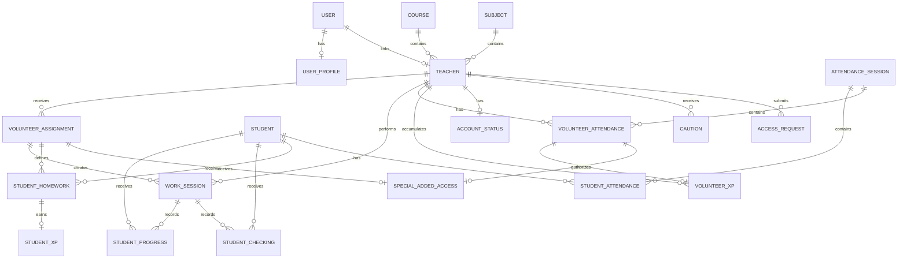

## API Reference

Base prefix: `/api/`. The Django `/admin/` route is also present.

| Method | Endpoint | Handler | Permission |
|---|---|---|---|
| POST | `/api/auth/login/` | `accounts.LoginView` | `AllowAny` |
| POST | `/api/auth/demo-login/` | `accounts.DemoLoginView` | `AllowAny`; gated by `DEMO_MODE` |
| POST | `/api/auth/forgot-password/` | `PasswordResetRequestView` | `AllowAny` |
| POST | `/api/auth/reset-password/<uidb64>/<token>/` | `PasswordResetConfirmView` | `AllowAny` |
| GET | `/api/auth/me/` | `CurrentUserView` | `IsAuthenticated` |
| GET | `/api/courses/courses/` | `CourseListView` | `AllowAny` |
| GET | `/api/courses/subjects/` | `SubjectListView` | `AllowAny` |
| POST | `/api/teachers/register/` | `TeacherRegistrationView` | Public registration |
| POST | `/api/teachers/login/` | `TeacherLoginView` | Public login |
| GET | `/api/teachers/dashboard/` | `VolunteerDashboardView` | `IsTeacherVolunteer` |
| GET | `/api/teachers/today-assignment/` | `VolunteerTodayAssignmentView` | `IsTeacherVolunteer` |
| GET | `/api/teachers/work-mode/` | `VolunteerWorkModeView` | `IsTeacherVolunteer` |
| POST | `/api/teachers/session/start/` | `VolunteerWorkSessionStartView` | `IsTeacherVolunteer` |
| POST | `/api/teachers/session/end/` | `VolunteerWorkSessionEndView` | `IsTeacherVolunteer` |
| GET | `/api/teachers/students/` | `VolunteerProgressStudentsView` | `IsTeacherVolunteer` |
| POST | `/api/teachers/progress/` | `VolunteerProgressSaveView` | `IsTeacherVolunteer` |
| GET | `/api/teachers/progress/students/` | `VolunteerProgressStudentsView` alias | `IsTeacherVolunteer` |
| POST | `/api/teachers/progress/save/` | `VolunteerProgressSaveView` alias | `IsTeacherVolunteer` |
| GET | `/api/teachers/special-added/available-work/` | `SpecialAddedAvailableWorkView` | `IsTeacherVolunteer` |
| POST | `/api/teachers/special-added/select-work/` | `SpecialAddedSelectWorkView` | `IsTeacherVolunteer` |
| GET | `/api/teachers/special-added/current-work/` | `SpecialAddedCurrentWorkView` | `IsTeacherVolunteer` |
| GET | `/api/teachers/checking/` | `VolunteerCheckingDashboardView` | `IsTeacherVolunteer` |
| GET | `/api/teachers/checking/students/<student_id>/` | `VolunteerCheckingStudentDetailView` | `IsTeacherVolunteer` |
| POST | `/api/teachers/checking/students/<student_id>/save/` | `VolunteerCheckingSaveView` | `IsTeacherVolunteer` |
| POST | `/api/students/register/` | `StudentRegistrationView` | `AllowAny` |
| POST | `/api/students/homework/<homework_id>/complete/` | `StudentHomeworkCompleteView` | Authenticated/student/admin as view logic |
| GET | `/api/students/<student_id>/xp/` | `StudentXPView` | Authenticated |
| GET | `/api/students/xp/leaderboard/` | `StudentXPLeaderboardView` | Authenticated |
| GET | `/api/students/<student_id>/14-day-history/` | `Student14DayHistoryView` | `IsAuthenticated` |
| POST | `/api/attendance/session/start/` | `StartAttendanceSessionView` | Admin 1/superuser |
| GET | `/api/attendance/session/current/` | `CurrentAttendanceSessionView` | Admin 1/superuser |
| POST | `/api/attendance/session/end/` | `EndAttendanceSessionView` | Admin 1/superuser |
| GET | `/api/attendance/students/` | `StudentAttendanceListView` | Admin 1/superuser |
| POST | `/api/attendance/students/save/` | `SaveStudentAttendanceView` | Admin 1/superuser |
| GET | `/api/attendance/volunteers/` | `VolunteerListView` | Admin 1/superuser |
| GET | `/api/attendance/volunteers/current/` | `CurrentVolunteerAttendanceView` | Admin 1/superuser |
| POST | `/api/attendance/volunteers/add/` | `AddVolunteerAttendanceView` | Admin 1/superuser |
| POST | `/api/attendance/volunteers/add-playing-day/` | `AddPlayingDayAttendanceView` | Admin 1/superuser |
| POST | `/api/attendance/volunteers/save/` | `SaveVolunteerAttendanceView` | Admin 1/superuser |
| GET | `/api/attendance/summary/` | `TodayAttendanceSummaryView` | Admin 1/superuser |
| GET | `/api/attendance/history/` | `AttendanceHistoryView` | Admin 1/superuser |
| GET/POST | `/api/admin2/daily-status/` | `DailySchoolStatusView` | `IsAdmin2` |
| GET/POST | `/api/admin2/holidays/` | `HolidayListCreateView` | `IsAdmin2` |
| PATCH | `/api/admin2/holidays/<holiday_id>/` | `HolidayDetailView` | `IsAdmin2` |
| GET | `/api/admin2/dashboard/` | `Admin2DashboardView` | `IsAdmin2` |
| GET | `/api/admin2/students/total/` | `TotalStudentsView` | `IsAdmin2` |
| GET | `/api/admin2/students/present-today/` | `PresentStudentsTodayView` | `IsAdmin2` |
| GET | `/api/admin2/volunteers/` | `RegisteredVolunteersView` | `IsAdmin2` |
| GET | `/api/admin2/volunteers/present-today/` | `PresentVolunteersTodayView` | `IsAdmin2` |
| GET | `/api/admin2/assignments/today/` | `TodayAssignmentsView` | `IsAdmin2` |
| GET | `/api/admin2/assignments/history/` | `AssignmentHistoryView` | `IsAdmin2` |
| POST | `/api/admin2/assignments/send/` | `SendAssignmentView` | `IsAdmin2` |
| GET | `/api/admin2/assignments/export-png/` | `DailyReportPNGView` | `IsAdmin2` |
| GET | `/api/admin2/assignments/export-excel/` | `AssignmentExcelExportView` | `IsAdmin2` |
| POST | `/api/admin2/assignments/<assignment_id>/retry-email/` | `RetryAssignmentEmailView` | `IsAdmin2` |
| GET | `/api/admin2/xp/<volunteer_id>/` | `VolunteerXPView` | `IsAdmin2` |
| POST | `/api/admin2/xp/adjust/` | `ManualXPView` | `IsAdmin2` |
| GET | `/api/admin2/cautions/` | `CautionListView` | `IsAdmin2` |
| GET | `/api/admin2/volunteers/<volunteer_id>/status/` | `VolunteerStatusView` | `IsAdmin2` |
| POST | `/api/admin2/volunteers/<volunteer_id>/remove/` | `RemoveVolunteerView` | `IsAdmin2` |
| GET | `/api/admin2/access-requests/` | `AccessRequestListView` | `IsAdmin2` |
| POST | `/api/admin2/access-requests/<request_id>/decide/` | `DecideAccessRequestView` | `IsAdmin2` |
| POST | `/api/admin2/volunteer/request-access/` | `VolunteerRequestAccessView` | `AllowAny` |
| GET/POST | `/admin/` | Django admin site | Django staff authentication |

## Key Data & Control Flows

### Volunteer signup

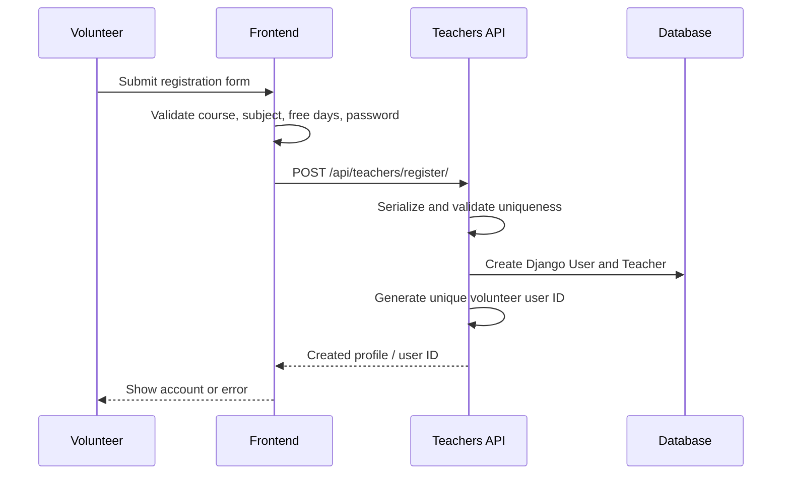

### Student registration

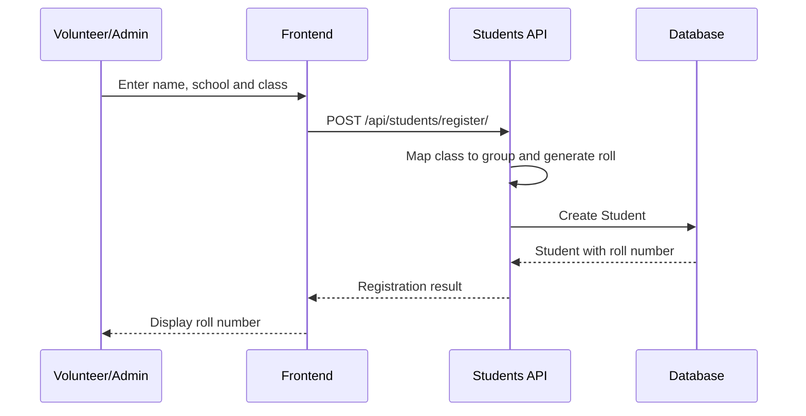

### Admin 1 login

```mermaid
sequenceDiagram
    participant A as Admin 1
    participant F as Frontend
    participant API as Accounts API
    participant DB as Database
    A->>F: Enter username/password
    F->>API: POST /api/auth/login/
    API->>DB: Authenticate Django User
    API->>DB: Read UserProfile.role
    API-->>F: 30-minute access + 7-day refresh; profile role
    F->>F: Persist tokens and role
    F-->>A: Navigate to attendance dashboard
```

### Admin 2 login

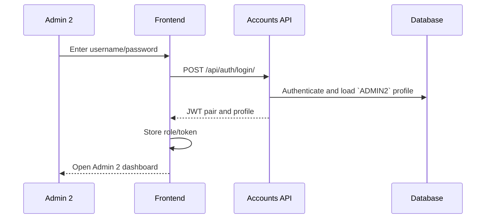

### Volunteer login

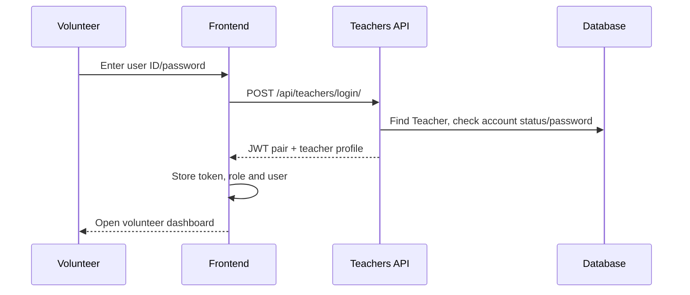

### Demo sign-in

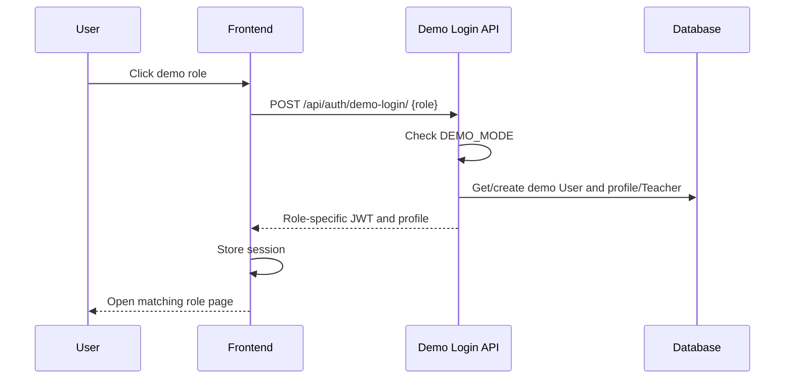

### Attendance session

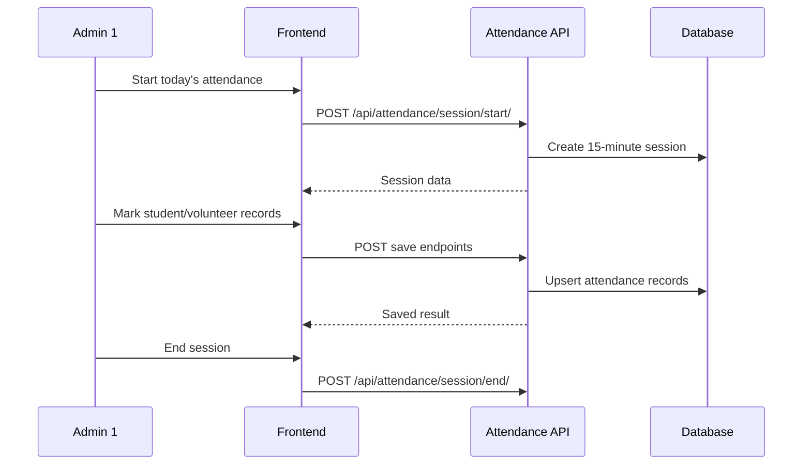

### Assignment and email flow

```mermaid
sequenceDiagram
    participant A as Admin 2
    participant F as Frontend
    participant API as Admin2 API
    participant DB as Database
    participant Mail as Gmail/Resend
    A->>F: Choose volunteer, class and task; attach files
    F->>API: POST /api/admin2/assignments/send/
    API->>DB: Create VolunteerAssignment
    API->>Mail: Send assignment email
    Mail-->>API: Sent or delivery error
    API->>DB: Update email status
    API-->>F: Assignment result
```

### Homework and XP

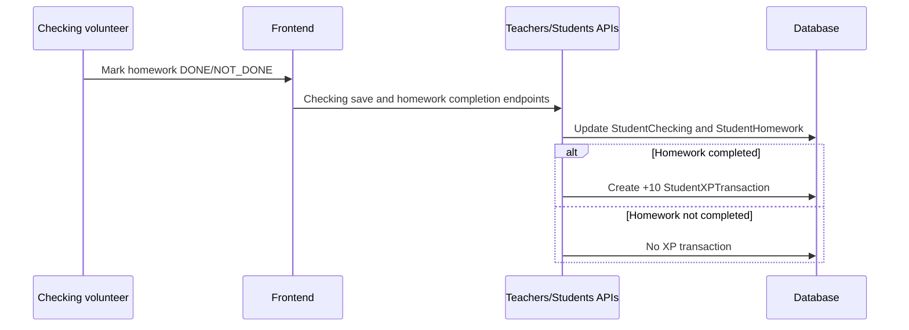

### Removal and re-access

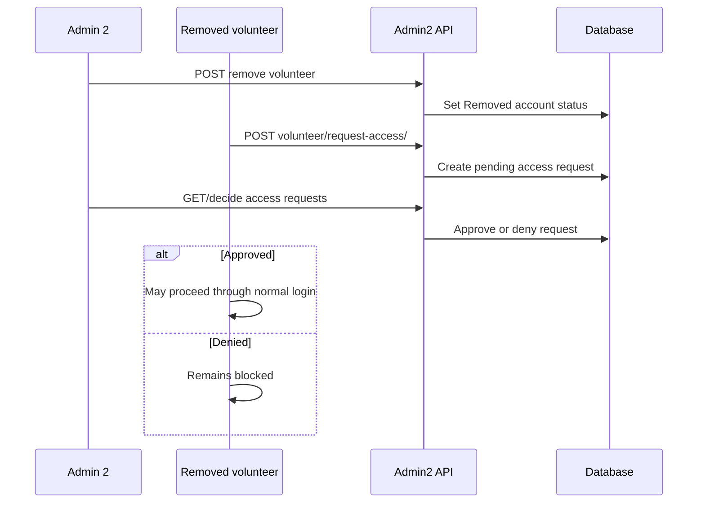

## Security Architecture

- Django REST Framework uses JWT bearer authentication and `IsAuthenticated` by default.
- SimpleJWT uses 30-minute access tokens and 7-day refresh tokens, with rotation and blacklist-after-rotation configured.
- Custom permissions distinguish superusers, Admin 1, Admin 2, Teacher/Volunteer and Student profiles.
- Public exceptions are explicit: demo login, login, password reset, course/subject lists, volunteer/student registration and removed-volunteer access request.
- Demo accounts receive unusable passwords and demo login is disabled unless `DEMO_MODE=true`.
- Password reset uses UID/token confirmation and a configurable frontend reset URL.
- CORS is allowlist-based from `CORS_ALLOWED_ORIGINS`.
- Production settings add browser XSS, content-type, frame, referrer and secure cookie protections.
- Django validates passwords with similarity, minimum length and Django user-attribute validators.
- `SECRET_KEY` is mandatory and startup raises if missing.
- Secrets and credentials should remain in environment variables rather than source.
- Remaining concern: frontend route protection is not consistently enforced and refresh logout behavior depends on 401 clearing.

## Configuration & Environment

Backend settings read:

| Variable | Purpose | Default |
|---|---|---|
| `SECRET_KEY` | Django signing secret | Required; no default |
| `DEBUG` | Debug mode | `False` |
| `DEMO_MODE` | Enable demo login | `False` |
| `ALLOWED_HOSTS` | Django allowed hostnames | Empty list |
| `USE_SQLITE` | Select SQLite instead of PostgreSQL | `False` |
| `DB_NAME`, `DB_USER`, `DB_PASSWORD`, `DB_HOST`, `DB_PORT` | PostgreSQL connection | `jaago_portal`, `postgres`, empty password, `localhost`, `5432` |
| `JAAGO_EMAIL_USER`, `JAAGO_EMAIL_PASSWORD` | Gmail SMTP credentials | Default sender exists; password empty |
| `CORS_ALLOWED_ORIGINS` | Frontend origins | `http://localhost:8080` |
| `JAAGO_FRONTEND_RESET_URL` | Password reset frontend base | `http://localhost:8080/reset-password` |
| `ADMIN1_USERNAME/PASSWORD`, `ADMIN2_USERNAME/PASSWORD` | Bootstrap/seed administrator accounts | Seed command defaults `admin1/admin123` and `admin2/admin123`; bootstrap requires values |
| `SUPERUSER_USERNAME/EMAIL/PASSWORD` | Django superuser bootstrap | Required for bootstrap command |
| `RESEND_API_KEY`, `RESEND_FROM_EMAIL` | Resend email delivery | Read in assignment views; no code default for API key |

Frontend configuration:

| Variable | Purpose | Default |
|---|---|---|
| `VITE_BACKEND_URL` | Django origin | `http://127.0.0.1:8000` |
| `VITE_API_BASE_URL` | API base | `${VITE_BACKEND_URL}/api` |

No `.env.example` file was found in the backend. The setup guide instructs copying one, but the named file is absent.

## Build/Run/Deployment

### Local frontend

```powershell
cd frontend
npm install
npm run dev
```

The setup guide says Vite runs at `http://localhost:8080`. Package scripts also include `npm run build`, `npm run build:dev`, `npm run preview`, `npm run lint`, and `npm run format`.

### Local backend

```powershell
cd backend
python -m venv venv
.\venv\Scripts\activate
pip install -r requirements.txt
python manage.py migrate
python manage.py seed_demo_data
python manage.py runserver
```

The setup guide runs the backend at `http://127.0.0.1:8000/`. Gunicorn is installed for WSGI deployment.

### Deployment indicators

- TanStack Start/Nitro configuration and a `.output/` directory indicate a deployable server build.
- The frontend is configured with `@lovable.dev/vite-tanstack-config` and Nitro Cloudflare defaults in comments.
- The backend supports PostgreSQL by default and SQLite through environment selection.
- Accounts contains deployment-oriented `bootstrap_admins` and `bootstrap_superuser` commands.
- No checked-in Dockerfile, compose file, or formal deployment manifest was found.

## Cross-Cutting Concerns

- **Timezone:** Django uses `Asia/Kolkata`; session and local dates are based on the backend timezone.
- **Media:** Assignment attachments are uploaded to `backend/media/admin2/...`, with `/media/` served in DEBUG.
- **Email:** Assignment flows use Resend with SMTP-related fallbacks/configuration; password reset uses Gmail SMTP.
- **Exports:** Daily reports export as PNG, while assignment lists export Excel.
- **Attendance:** Student and volunteer attendance use unique constraints per session; student/volunteer choices and substitute logic are handled by API views.
- **XP:** Volunteer XP supports attendance, special-added presence and manual adjustment; student XP is tied to completed homework.
- **Caution/removal:** Cautions focus on consecutive assigned absences; removal creates account status and access-request workflows.
- **Error handling:** Axios clears auth state on non-login 401, while route components generally display response/detail text.
- **Testing:** Django test modules exist in several apps; no frontend test script is declared in `package.json`.

## Dependency Map

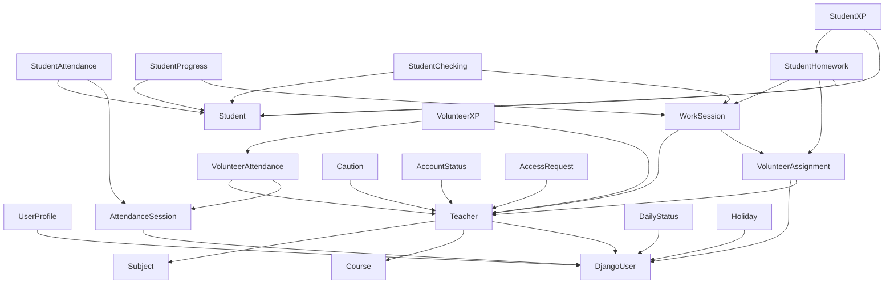

## Discrepancies & Technical Debt

- `timetable` is installed but has no models, views or URL configuration.
- The setup guide says to copy `.env.example`, but no `.env.example` is present.
- Refresh tokens are issued and stored, but `accounts/urls.py` does not expose a refresh endpoint.
- Many frontend role pages have no TanStack route-level guard; protection depends on JWT API calls.
- Demo login is implemented in the backend, but normal demo/admin seeding credentials and demo-mode credentials differ: seed accounts use `admin1/admin123` and `admin2/admin123`, while demo mode creates unusable-password users named `demo_admin1` and `demo_admin2`.
- Course/subject API URLs are `/api/courses/courses/` and `/api/courses/subjects/` because `config.urls` mounts `courses.urls` at `/api/`.
- Student group mapping in code maps LKG/UKG to E, 1-3 to A, 4-6 to B, 7-8 to C, 9-10 to D. The initial requirements PDF lists a different A-E ordering. The code and PDF should be reconciled.
- The generated `.output/` directory is present and should normally be treated as build output rather than source.
- `test_real_email.py` contains hard-coded sender/receiver values and is not a configurable test.
- The seed command catches demo-volunteer errors and only emits a warning rather than failing.
- Several route components use direct component-local fetching rather than React Query, so cache/loading behavior is inconsistent.
- `Django 6.1.1` is unusually current for this package set; deployment compatibility may depend on the runtime Python version.
- The source contains backup and models-before-module files in app folders; these are not runtime registrations but may confuse maintenance.
- No formal database migrations inventory or seed migration is described in this document beyond Django migrations folders.

## Improvement Recommendations

1. Add route-level role guards and a centralized unauthorized redirect component.
2. Add a `/api/auth/token/refresh/` endpoint or remove refresh-token handling from the frontend.
3. Add and document `.env.example` with all variables listed above.
4. Unify student class/group mapping with the product requirements and add tests for every class.
5. Replace hard-coded real-email test values with environment/configurable test addresses.
6. Move `.output/`, `dist`, and build caches out of source/change workflows or confirm ignore policy.
7. Consolidate generated/backup files and remove dead timetable or backup artifacts.
8. Add frontend route and API integration tests around role login, demo mode and token expiry.
9. Define and test permissions consistently per endpoint rather than relying on view-local logic.
10. Use React Query consistently for server state and shared loading/error handling.
11. Add deployment manifests and documented Gunicorn/PostgreSQL/Nitro/Cloudflare procedures.

## Glossary

- **Admin 1:** Role responsible for daily attendance sessions and student/volunteer attendance records.
- **Admin 2:** Role responsible for school-day status, holidays, assignments, volunteers, cautions, removals and access requests.
- **AttendanceSession:** Timed attendance work session controlled by Admin 1.
- **Caution:** Active warning for a volunteer based on consecutive assigned absences.
- **Checking team:** Volunteers assigned to inspect student homework.
- **Demo mode:** Environment-gated login flow that creates/uses demo users.
- **Holiday:** Active school closure attached to a unique date.
- **Playing day:** School-day status with no ordinary assignments but volunteer attendance.
- **Regular class:** School-day status with teaching/checking assignments.
- **Special Added:** Present volunteer authorized to replace exactly one absent assigned volunteer for a work item.
- **Teaching team:** Volunteers assigned to deliver lessons.
- **Volunteer work session:** Timed work execution associated with a volunteer assignment.
- **XP:** Experience points earned from attendance, homework and special/manual adjustments.
